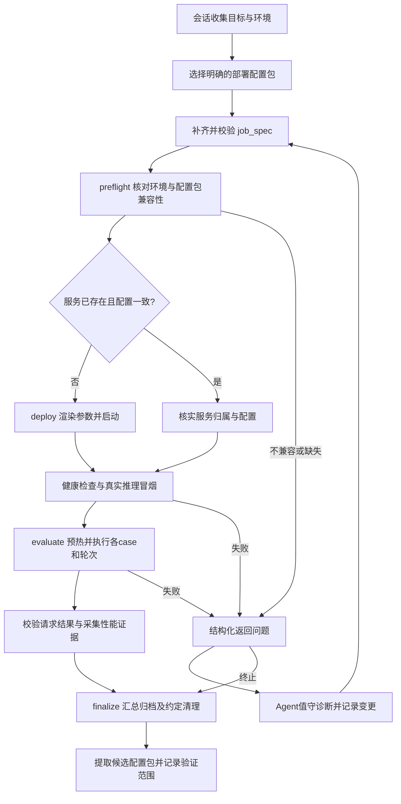
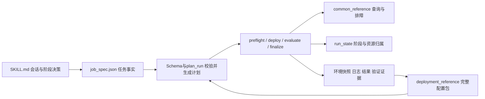

# 模型拉起与评测 Skill：初版设计报告

日期：2026-10-30。本文为后续实现依据；不代表所描述执行能力已经完成。

## 1. 范围与核心取舍

首版服务于确定环境下的模型自动拉起、真实推理验证和 AISBench 性能评测。保留 Agent 驱动的 plan-test 五阶段流程。通用排障命令相对容易复用，放入 common_reference；重点解决模型启动配置随镜像、模型和部署形态变化的问题。

最简单的实现是保存一套完整的、绑定具体环境的启动配置包，由用户与 Agent 显式选用。首版不做命令拆散重组、版本优先级评分、跨镜像自动适配或“找最接近版本”回退。一个配置包中的 P、D、代理、环境变量和必要补丁作为整体管理，避免混用不同验证组合。

## 2. Skill 完成后的任务流程



PD 冒烟必须走代理，并有 P、D 两端参与及 KV 交接证据；health 或 HTTP200 不足以通过。正式测试分别统计预热和测量，目标前缀比例与实际命中率分开。已有服务的复用必须验证配置，不能仅因端口开放就跳过部署核验。

## 3. 模块与文件职责



| 文件/模块 | 职责与边界 |
| --- | --- |
| SKILL.md | 引导信息采集、选择配置包、解释脚本结果；不能用文字替代脚本校验 |
| job_spec + Schema | 本次目标、参数、测试与边界；字段和跨字段约束由代码执行 |
| plan_run.py / plan.json | 收敛并固化计划、配置哈希；不宣称运行环境已验证 |
| preflight.py | 核对实际镜像、源码、模型、硬件、文件、端口及资源占用 |
| deploy.py | 根据选定包渲染配置、记录差异、启动服务和执行冒烟 |
| evaluate.py | 验证冒烟证据、执行case与轮次、检查失败和输出指标 |
| finalize.py | 汇总、归档、按约定保留或清理本任务资源 |
| run_state.json | 阶段、尝试、错误、产物、PID及启动时间；不回写目标参数 |
| deployment_reference | 一套验证组合的环境条件、完整启动配置与证据 |
| common_reference | 占用查询、版本采集、日志检查等通用操作，仍需声明前置条件 |

### job_spec 顶层目标结构

| 字段 | 描述 |
| --- | --- |
| schema_version | 契约版本 |
| job | ID、任务目标、评测类型 |
| target | 主机、访问方式和工作目录，不保存凭据 |
| runtime | 容器、镜像摘要、软件版本、执行位置 |
| model | 权重、tokenizer、模型标识 |
| deployment | 实例、DP/TP/EP、卡、网络、KV、代理及启动参数 |
| benchmark | 工具、数据、case、轮次、预热与缓存隔离 |
| acceptance | 冒烟与评测通过条件 |
| execution | 值守模式、超时、重试、允许调整范围；调度可选 |
| artifacts | 结果、日志、快照输出位置及保留策略 |
| cleanup | 任务进程和临时文件清理范围、是否保留服务 |
| references | 配置包ID/修订及其哈希，通用参考引用 |
| unresolved | 待确认信息，禁止带未解决执行条件进入运行 |

上述结构已讨论确认，后续可优化。当前实现仍是较早的 v1 字段结构，迁移时必须同步修改 Schema、plan_run、示例和测试，不能只改文档或静默接受两种格式。参数要求与实测环境快照分离；状态ready只表示信息完整，不代表部署成功。

## 4. 模型配置包：首版存储设计

建议布局（待实现，不代表当前目录已具备）：

```text
references/
  common_reference/
    npu-ownership/
    environment-inspection/
  deployment_reference/
    <bundle-id>/
      manifest.json
      parameters.schema.json
      scripts/             # 完整P/D、proxy、环境脚本
      patches/             # 确有需要时附源码前置条件
      validation.json      # 环境、验收范围及证据索引
```

不把“按模型还是按版本”变成首版目录优先级问题。bundle-id 用稳定名字标识一套组合，manifest 同时记录模型、镜像与硬件。可用人类可读名称帮助检索，但机器兼容性依据字段，不能依赖目录名称猜测。

manifest 至少记录：id、revision、status、模型配置/权重标识、硬件型号、镜像完整摘要、容器内软件版本和源码提交/补丁哈希、部署形态、各脚本哈希、允许参数及验证证据。镜像标签可用于展示，不能替代摘要；同一镜像内安装过新包或修改过源码也需记录。

### 参数边界

- 现场参数：IP、网卡、目录、容器名、可用端口等，经参数Schema校验并检查相互引用一致性。
- 验证配置：DP/TP、卡数、KV Connector、block size、精度、推测解码、环境变量等，保留整套验证值。
- 测试参数：输入输出长度、总并发、请求数、前缀比例和轮次由 job_spec 提供，不混进镜像兼容配置。

不允许未知字段或任意字符串拼接进Shell。渲染后的脚本/配置必须归档并与模板比较；模板允许变化的字段不等于换新机后免验证。端口、设备和拓扑仍由预检核实。

### 兼容性判定

首版要求显式指定 bundle-id/revision。preflight 比对 manifest 中要求的镜像摘要、版本、模型及部署条件；不匹配则返回差异，由值守人员决定是否建立新的 candidate 包。禁止自动套用邻近版本，禁止从多个包抽取部分启动参数拼成未经验证的组合。

匹配配置包后仍要现场冒烟。真实环境失败时进入排障；不把参数语法通过视为部署可用。源码补丁必须检查目标源码特征、备份并验证，不能因模型同名就直接应用。

## 5. 命令与配置归档流程

1. 现场成功执行时保存原始脚本、参数、镜像摘要、软件/源码差异、模型配置、日志及验收结果。
2. 模型启动命令以完整组合归档；无模型依赖且验证可复用的检查命令提取到 common_reference。
3. 去除凭据与个人路径，参数化现场字段，生成 candidate 配置包及哈希。保留许可证和来源。
4. 使用参数化后的包重新启动并通过明确验收；原始命令成功不自动证明模板成功。
5. 记录验证范围：例如只通过部署和短请求，不得称为长上下文64并发已验证。部署验证与各测试case结果分别记录。
6. 升级镜像、改变模型或核心启动参数时新增修订，保留旧证据，不覆盖既有verified记录。发现不再适用可标deprecated并给出原因。

当前迁移材料仍为 candidate：完成了代码修改和静态检查，未完成本会话下修复后的PD及四组测评。验证后提炼到正式配置包，按迁移说明清理重复快照，避免长期维护两套脚本。

## 6. 最小落地顺序与验收

1. 将 job_spec 归组落实到Schema与规划器，增加 references 的显式包选择。
2. 固化一套真实验证组合的 manifest 和完整脚本；实现确定性参数渲染与差异检查，不做通用匹配引擎。
3. 实现 preflight 与 deploy，完成“核对环境→拉起→真实PD冒烟”闭环。
4. 接入 AISBench 四组case，处理上游退出码、SSE错误、缓存隔离、指标采集和结果判定。
5. 实现本任务归属清理与结果归档，完成一轮值守测试后再扩展多轮和无人值守。

首版应通过：镜像不匹配被拒绝、缺参数被拒绝、非法参数不进入命令、实例拓扑一致、真实冒烟证据可追溯、失败请求不计成功、清理不影响他人。没有任何已验证配置包时应明确返回缺失，不假装自动部署可用。

当前已实现：job_spec v1校验、plan_run计划生成、迁移源码包、信息收集文档。其余阶段仍为BLOCKED占位；本报告只更新设计，不在服务器执行测试或启动服务。
